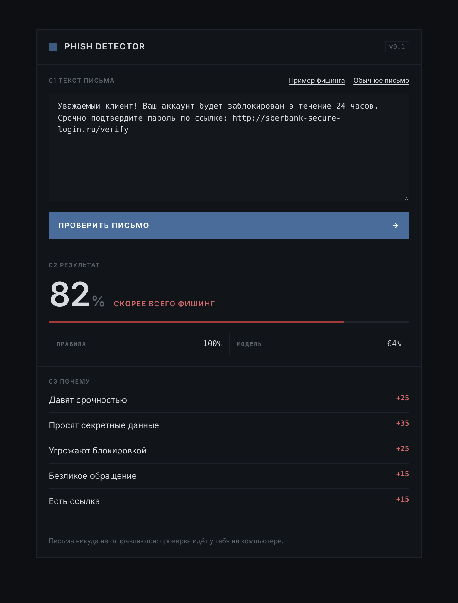

# Phish Detector

A bilingual (English + Russian) phishing email detector that combines **hand-written security rules** with a **machine learning model** trained on 82,000+ real emails.

Paste the text of a suspicious email and get a danger score from 0 to 100% plus a plain-language list of *why* it looks like phishing.



## Why I built it

Phishing is the most common way people lose accounts and money online, and the people around me (classmates, parents, grandparents) get these emails and texts every week. I wanted a tool that doesn't just say "dangerous" but explains the warning signs, so people learn to spot them on their own.

## How it works

The score is the average of two independent checks:

**1. Rules (`rules.py`)**: signs that security experts teach people to look for:

| Sign | Example |
|---|---|
| Urgency | "within 24 hours", "срочно" |
| Asking for secrets | password, SMS code, card number, CVV |
| Threats | "your account will be suspended", "заблокирован" |
| Too good to be true | "you won a prize", "компенсация" |
| Impersonal greeting | "Dear customer", "Уважаемый клиент" |
| Request to pay | "pay the fee", "оплатите" |
| Suspicious attachment | "open the file invoice.zip" |
| Contains a link | any `http(s)://` URL |

Each sign adds points, and every sign that fires is shown to the user as an explanation.

**2. Machine learning model (`train_model.py`)**: a TF-IDF + Logistic Regression model (scikit-learn). TF-IDF turns each email into numbers based on which words it contains and how distinctive they are; logistic regression learns which words make an email more likely to be phishing.

## Results

| Experiment | Accuracy |
|---|---|
| Model trained on 30 sample emails | unsure on new emails (~46% confidence on a normal email) |
| Model trained on 82,486 English emails ([Kaggle phishing email dataset](https://www.kaggle.com/datasets)), tested on 16,500 emails it never saw | **98%** |
| Same model, tested on mixed English + Russian emails | 70% |
| After adding Russian training emails | **87%** |
| Rules on the 30-email test set | 30 / 30 correct |

## What I learned

- **A model only knows the language it was trained on.** The English-only model was close to guessing on Russian emails. Adding a small Russian set, weighted so it isn't drowned out by 66,000 English emails, raised accuracy from 70% to 87%.
- **More data beats clever code.** The same 15 lines of training code went from "unsure" to 98% accuracy just by training on more emails.
- **Rules and ML complement each other.** Rules are explainable and work in any language from day one; the model catches patterns no one wrote a rule for.
- **Test on data the model hasn't seen.** I split the data 80/20, otherwise accuracy would be misleadingly high.

## Run it yourself

```bash
pip install -r requirements.txt
# download phishing_email.csv from Kaggle into data/
python train_model.py      # trains the model, prints accuracy
python check.py            # runs the self-check on 30 test emails
python app.py              # open http://127.0.0.1:5050
```

## Project structure

```
rules.py              rule-based detection
train_model.py        model training
app.py                web server (Flask)
templates/, static/   web page and styles
check.py              automated self-check
data/                 test emails and Russian training emails
```

## Credits

The detection rules and model training are my work. The web interface, the self-check script and the Russian training examples were built with the help of an AI assistant (Claude). The large training dataset is a public phishing email dataset from Kaggle.
